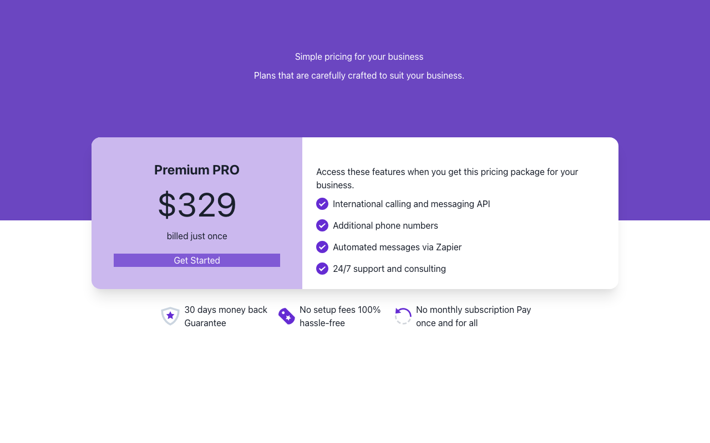

# NextJS PIAIC

Coursework monorepo from the PIAIC Next.js program: a collection of independent learning projects, each with its own `package.json` and lockfile.



*Screenshot of `pricing-ui-nextjs-13` running with `npm run dev`, captured with Playwright.*

## Projects

| Folder | What it is |
| --- | --- |
| `learn-nextjs/` | Step-by-step lessons and assignments (routing, rendering, styling, APIs, CMS, middleware, state) |
| `pricing-ui-nextjs-13/` | Pricing card UI (Next.js 13, Chakra UI) |
| `todo-app-nextjs/`, `panaverse-syllabus-app/` | Small apps |
| `nextjs-gaming-website/`, `nextjs-ripseed-website/` | Landing-page style sites |
| `hackathon/` | Hackathon storefront (Sanity, Stripe, Clerk) |
| `commerce/`, `nextjs-commerce/` | Copies of Vercel's Next.js Commerce (see their own license) |
| `nextjs-13.2/`, `truthy/` | Next.js experiments |
| `nextjs-13-docs-offline/` | Offline snapshot of the Next.js 13 docs |
| `nestjs-crash-course-baseline-cli-app-module-01/`, `react-nestjs-full-web-app/` | NestJS exercises |

## Run a project

```bash
cd pricing-ui-nextjs-13
npm ci
npm run dev   # http://localhost:3000
```

Other projects work the same way; use the lockfile present in each folder (npm, pnpm or yarn). Projects needing API keys (`hackathon/`, `commerce/`, CMS lessons) require your own values; copy `.env.example` where one exists.

## License

MIT, see [LICENSE](LICENSE). Sub-projects that ship their own license (for example the Next.js Commerce copies) keep it.
